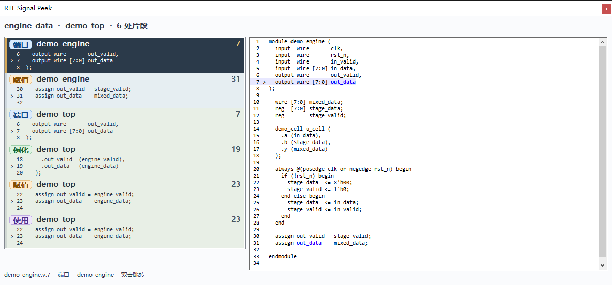

# RTL Signal Peek for Notepad++

在 Notepad++ 里按住 `Ctrl` 单击 Verilog/SystemVerilog 信号名，弹出悬浮窗列出该信号的端口、例化、赋值和使用位置，右侧预览完整源码，双击跳转。查询在独立 `node` 进程中完成，不修改编辑缓冲区，也不压缩编辑区域。



以演示文件中的 `engine_data` 为例：左侧按模块分组列出端口、赋值、例化与使用片段，右侧显示完整源码并居中高亮目标行。

> [!IMPORTANT]
> 本仓库只保存源码，**不包含**可直接加载的 `RtlSignalPeek.dll`。不要下载 GitHub 的 `Code -> Download ZIP`，那是源码包，安装后插件不会出现在 Notepad++ 中。
>
> 请从 [Releases](https://github.com/AGouzi/npp-rtl-signal-peek/releases/latest) 下载 `RtlSignalPeek.zip`，再按下方“安装”章节解压到 `plugins\RtlSignalPeek\`。查询功能还需要 64 位 Node.js。

## 设计原理

- **点击即查询，不常驻解析**：C++ 插件只负责取光标下的标识符、弹出面板和读取源码片段；解析与连接追踪交给 `js\query.js`，每次点击启动一个 `node` 进程，查询完即退出。查询进程异常不会带崩 Notepad++。
- **范围本地优先**：先看 `sourceRoot` 或已固定的工程根；否则从当前文件目录向下搜索，最多向上 `upLevels` 层，遇到 Desktop、用户目录、盘符根目录自动停止。范围受 `maxFiles` 和 `maxIndexMs` 预算约束，超限时返回部分结果并明确提示。
- **三级检索，精度递减**：优先 Verilator `netgraph`（elaborate 后的真实 AST 连接）；没有连接图时用轻量模块索引（解析 `module`、端口、例化和 `assign`，跨文件追踪）；再失败才退回同名文本索引。状态栏会标明当前用的哪一级。
- **连接图是快照，必须可失效**：`manifest` 记录源文件哈希和修改时间；连接图过期或缺失时明确降级并提示，不拿旧行号冒充真实连接。
- **源码预览由 C++ 读取**：透明加密环境里只要 Notepad++ 能解密，预览就正常；`node` 只负责结构化查询。

## 功能

- `Ctrl+单击` 信号名打开临时悬浮窗；配置后可改为 `Alt+单击`。
- 左侧按位置列出端口、例化、赋值和使用片段。
- 左侧端口、例化、赋值、使用分类使用不同颜色的标签。
- 鼠标悬停片段时，右侧显示该文件完整源码并将目标行居中高亮。
- 右侧源码预览只标出当前信号及当前片段对应的信号名，其余正文保持统一颜色，不再做前缀猜测着色。
- 双击片段跳转到源码后，目标行会在 Notepad++ 编辑器内垂直居中。
- 双击片段或按 `Enter` 跳转到真实文件的对应行。
- 不同模块的结果使用莫兰迪浅色背景和左侧色条；选中行使用深墨色 + 金色强调；模块名左对齐、行号右对齐。跳转后目标行会滚动到编辑器可视区域中部。
- 结果先按模块名分组，同一模块内按行号升序排列，便于沿模块连续阅读。
- 点击编辑器、点击悬浮窗关闭按钮或按 `Esc` 隐藏悬浮窗；再次单击信号可重新打开。
- 菜单命令 `RTL: 查看光标下信号` 与单击等效。
- 菜单命令 `RTL: 参数设置...` 可以直接调整范围、预算、排除目录和点击修饰键，保存后写入 `RtlSignalPeek.ini`。
- 菜单命令 `RTL: 固定当前目录为工程根` / `RTL: 清除当前目录的工程根`，按目录记住范围，不用维护全局路径清单。
- 悬浮窗固定居中显示，支持拖动、缩放，关闭后保留上次结果。

## 安装

两种方式：

1. **预编译包（推荐）**：从 [Releases](https://github.com/AGouzi/npp-rtl-signal-peek/releases/latest) 下载 `RtlSignalPeek.zip`。不要下载 GitHub 的 `Code -> Download ZIP`，那是源码，不包含 DLL。
2. **源码安装**：需要 MinGW-w64 g++ 和 Node.js，运行 `.\build.ps1 -Install`；脚本会编译 DLL、打包并复制到插件目录，同时保留已有的 `RtlSignalPeek.ini`。

安装预编译包前先关闭 Notepad++，把 ZIP **里面的内容**解压到下面的目录。不要再套一层 `RtlSignalPeek`：

目标目录：

```text
<Notepad++ 安装目录>\plugins\RtlSignalPeek\
```

正确结果是能直接看到 `plugins\RtlSignalPeek\RtlSignalPeek.dll`。

插件查询需要 64 位 [Node.js](https://nodejs.org/)。请确保 `node.exe` 已加入 `PATH`，或在 `RtlSignalPeek.ini` 中把 `nodeExe` 设置为实际路径。

目录内至少需要：

```text
RtlSignalPeek.dll
RtlSignalPeek.ini
js\query.js
js\netgraph-client.js
js\hierarchy.js
tools\build_netgraph.js
tools\netgraph-core.js
demo\rtl\
demo\netgraph\
```

安装后重启 Notepad++。演示文件为 `demo\rtl\demo_top.v`，`Ctrl+单击` `engine_data` 即可验证。

## 使用

1. 打开 `.v` / `.sv` 文件，把光标放到信号名上，按住 `Ctrl` 单击；也可以走菜单 `RTL: 查看光标下信号`。
2. 左侧按 端口 / 例化 / 赋值 / 使用 分类；鼠标悬停某条结果，右侧显示完整源码并将目标行居中高亮。
3. 双击结果或按 `Enter` 跳转到真实文件；`Esc`、点击编辑器或关闭按钮隐藏面板。
4. 没有 `netgraph` 的工程会自动使用模块索引；状态栏会显示当前是 `模块索引`、`文本索引` 还是 `连接图已过期`。
5. 想换修饰键，改 `RtlSignalPeek.ini` 的 `clickModifier`，下次点击生效，不用重启 Notepad++。
6. 自动范围不够时，走菜单 `RTL: 固定当前目录为工程根`；不用修改 `sourceRoot`。

## 配置

编辑 `RtlSignalPeek.ini`：

```ini
[rtl]
nodeExe=node.exe
queryScript=js\query.js
sourceRoot=demo\rtl
netgraphDir=demo\netgraph
netgraphSourceRoot=demo\rtl
topModule=demo_top
clickModifier=Ctrl
upLevels=2
downLevels=8
maxFiles=2000
maxIndexMs=2000
excludeDirs=archive;backup;doc;ai_output;.Xil
```

- `clickModifier`：`Ctrl`、`Alt` 或 `Ctrl+Alt`；修改后下次点击生效。
- `sourceRoot`：可选的全局显式搜索根；多个目录使用英文分号分隔。更具体的固定工程根会覆盖它；正常使用不需要把每个工程都加进来。
- `netgraphDir`：Verilator AST 连接图目录；作为显式覆盖使用。
- `netgraphSourceRoot`：`netgraphDir` 对应的源码根目录；该目录内使用 AST 精确连接。
- `topModule`：顶层模块名。
- `upLevels`：从当前文件目录最多向上几层，默认 `2`；`0` 表示只看当前目录。
- `downLevels`：向下递归层数，默认 `8`。
- `maxFiles`：候选范围最多索引多少个 RTL 文件，默认 `2000`；超过时退回上一层或标记部分结果。
- `maxIndexMs`：模块索引时间预算，默认 `2000` 毫秒；超时返回已有结果。
- `excludeDirs`：额外跳过的目录名或绝对路径，分号分隔。
- 相对路径均相对于插件 DLL 所在目录。

上述参数也可以从菜单 `RTL: 参数设置...` 修改，保存后立即生效并写回 INI；不需要手动编辑文件。

修改 `RtlSignalPeek.ini` 后不需要重启 Notepad++；插件会在下一次查询前检查文件修改时间并重新加载。`clickModifier` 也会在下次点击时生效。

## 自动工程范围

当前文件不在任何 `sourceRoot` 或固定工程根下时，查询脚本按“本地优先”推导范围：

1. 从文件目录向上最多 6 层寻找强工程标记：`*.xpr`、`*.xise`、`*.qpf`、`*.qsf`、`*.gprj`、`*.prj`、`*.spj`，或当前文件确实位于其中的 `*.srcs` 目录。
2. 标记目录必须能通过预算探测：至少包含一个 RTL 文件，且不超过 `maxFiles`；否则忽略，避免把多工程公共父目录当成工程根。
3. 没有可用标记时，从当前目录向上最多 `upLevels` 层，选择不超过 `maxFiles` 的最大范围；遇到 Desktop、`%USERPROFILE%`、盘符根目录立即停止。
4. 当前文件本身就在 Desktop 等容器目录时，默认只扫描当前层，不递归子目录；需要跨子目录时用菜单固定工程根。
5. 向下递归最多 `downLevels` 层；`maxFiles` 或 `maxIndexMs` 超限时状态栏标记“已限制”或“部分源码”。

目录名不再决定工程边界：`rtl`、`src`、`hdl` 等只用于辅助扫描，代码放在任意命名文件夹里也会以当前目录为起点。Vivado 工程仍然优先识别 `*.srcs`；`.runs`、`.cache`、`.hw`、`.sim`、`.ip_user_files`、`ip`、`bd`、`_work` 等生成/临时目录，以及 `*_sim_netlist.v`、`*_rfs.v` 等生成文件会被跳过。

固定工程根由菜单管理，记录在 `%APPDATA%\RtlSignalPeek\scopes.txt`；按目录最长匹配生效，不需要手写 INI。独立 `.v` 文件夹没有 `netgraph` 时会建立模块索引并按例化端口和 `assign` 跟踪；索引失败时才退回同名文本匹配。

## 模块索引

没有 `netgraph` 时，查询不会只做同名文本匹配，而是先在当前工程范围（当前文件夹及其子目录，或自动识别的工程根）内建一个轻量模块索引：

- 解析 `module` / `endmodule`、端口方向、例化类型与 `.port(expr)` 连接、`assign` 赋值。
- 从当前信号出发，沿例化引脚向下找到子模块端口，沿父层例化向上找到连接网线；普通 `assign 别名` 只跟踪一跳，继续点结果可以逐层展开。
- 每条结果都带本行所属模块的局部信号名，点击后从该信号重新查询，不会把父层名字带到子模块。
- 向上查找会跳过 `tb_*` / `*_tb` 测试平台，避免从设计模块串进 testbench。
- 限制：4 层 / 80 个节点 / 160 条记录，同一模块最多占 64 条，避免时钟类大扇出挤掉跨模块结果；索引最多解析 `maxIndexMs`（默认 2 秒）、16 MB 源码，超出时标记“部分源码”。
- 当前文件超过 4 MB 时不读取全文，状态栏直接提示“文件超过 4 MB，未执行索引”。
- 这是正则级解析，不做预处理展开，也不解析 generate 循环、参数化位宽和跨模块宏；同名模块重复定义时取第一个。要更高精度仍然需要 Verilator `netgraph`。
调试时可用 `--text-index` 强制回到旧的同名文本索引。

## 工程内连接图

除 `netgraphDir` 外，插件会自动发现工程根下的连接图：

```
<工程根>\.rtl-peek\netgraph\manifest.json
```

当前文件所属工程根及其上 3 级父目录都会检查；找到后无需修改 `RtlSignalPeek.ini`。显式配置的 `netgraphDir` 优先，只有当前文件不在 `netgraphSourceRoot` 内时才回退到自动发现。

连接图是快照，必须能判断是否过期：

- `manifest.sourceMtimes` 存在时，逐文件比较修改时间；任一源文件更新或缺失即判定过期。
- 没有 `sourceMtimes` 但有 `sourceFiles` 且总大小不超过 8 MB 时，按 SHA-256 校验内容。
- 判定过期或无法校验时，状态栏会明确写出 `连接图已过期` 或 `连接图未校验`，并降级为文本索引，不会拿旧行号冒充真实连接。

### 生成连接图

插件只读取连接图，不负责编译 RTL。仓库自带 `tools\build_netgraph.js`，在插件目录下运行：

```powershell
node tools\build_netgraph.js `
  --source-root <工程根> `
  --rtl <工程根>\rtl `
  --top <顶层模块>
```

- `--source-root`：工程根，决定 `.rtl-peek\netgraph` 的位置和清单里的相对路径。
- `--rtl`：可重复。只扫描这些目录，默认扫描 `<工程根>\*.srcs\sources_1`；递归包含子目录，跳过备份、`*_sim_netlist`、`tb_*` 和生成目录。
- `--top`：主顶层模块。主树之外的独立模块会自动作为补充根再 elaborate 一次，因此打开任意模块都能查。
- `--include`：可重复，传给 Verilator 的 `-I` 头文件目录。
- `--blackbox`：可重复，手写的 IP/原语空壳，只保留端口连接。
- `--blackbox-port`：可重复，从 IP wrapper 源码解析端口并自动生成黑盒，适合不展开的 IP/BD wrapper。
- `--out`：输出目录，默认 `<工程根>\.rtl-peek\netgraph`。
- `--keep-temp`：保留临时目录，便于排查 Verilator 错误。

生成后插件自动发现，不需要修改 `RtlSignalPeek.ini`。仓库不附带任何厂商或项目专用黑盒；需要边界模型时，用 `--blackbox` 或 `--blackbox-port` 提供。

边界：连接图只覆盖 `--rtl` 扫描到的文件；IP/BD 黑盒只保留边界端口。新增文件后需要重新生成，否则打开该文件时会明确降级为模块索引。

## 新工程

1. 直接打开新工程的 RTL 文件，`Ctrl+单击` 信号名即可，不需要修改 `sourceRoot`，也不需要重启 Notepad++；自动范围不够用时，走菜单 `RTL: 固定当前目录为工程根`。
2. 如果新工程已有自己的 Verilator `netgraph`，放到 `<工程根>\.rtl-peek\netgraph` 即可自动启用；也可以用 `netgraphDir` 和 `netgraphSourceRoot` 显式指向；没有连接图时自动使用模块索引。
3. `sourceRoot` 仍可用于批量固定多个搜索根；单个工程优先用菜单固定工程根，避免全局路径清单越来越长。

文本索引能列出同一信号在同一源码树中的端口、例化和赋值/使用位置，但没有跨模块 AST 别名追踪，精度低于真实 `netgraph`。

## 编译

需要 MinGW-w64 g++（x64）和 Node.js。脚本默认输出到 `build\` 和 `dist\`：

```powershell
.\build.ps1
```

安装到本机 Notepad++（安装前先关闭 Notepad++）：

```powershell
.\build.ps1 -Install
```

等价的手工编译命令：

```powershell
g++ -std=c++20 -O2 -shared -static -DUNICODE -D_UNICODE `
  -finput-charset=UTF-8 -fexec-charset=UTF-8 `
  -Ivendor src\RtlSignalPeek.cpp `
  -o build\RtlSignalPeek.dll `
  -luser32 -lgdi32 -lcomctl32 -lshlwapi -lole32 -loleaut32 -luuid
```

## 真实工程限制

- 当前 `demo\netgraph` 是随插件附带的演示数据，只适合演示。真实工程用 `tools\build_netgraph.js` 重新生成，否则行号和连接关系会过期。
- `netgraph` 由 Verilator elaborate 后的 AST 生成（`--json-only`）；插件只读取生成的 JSON，不参与 RTL 编译，也不修改工程源文件。
- 预览源码由 Notepad++ 进程内的 C++ 插件读取，AST 查询只读 `netgraph`，文本索引由 `node` 读取 RTL 源文件。如果透明加密只允许 Notepad++ 解密，`node` 可能读到密文；需要把 `node.exe` 加入解密白名单，或在可解密环境生成 `netgraph`。
- 没有 `netgraph` 时先用模块索引，仍失败才退回同名文本索引；文本索引只能作为兜底，不应视为真实跨模块连接。
- 当前列表是扁平片段列表，没有实例树、返回栈和模块检查器。
